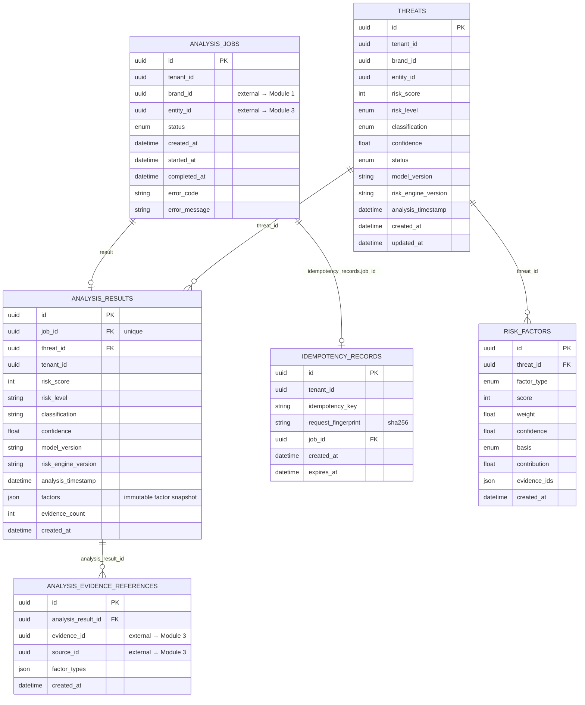

# Module 2 — Data Model

SQLAlchemy 2.x, `app/models/`. Migrations: `alembic/versions/f15fb873cb2f_module_2_initial_tables.py`.
UUID primary keys (`app/models/base.py UUIDPrimaryKeyMixin`), UTC datetimes
via the `UTCDateTime` TypeDecorator (portable tz handling — SQLite has no
native tz type).

Design rule: `brand_id`, `entity_id`, `evidence_id`, `source_id` are
**external references** (UUIDs owned by Modules 1/3). No foreign keys are
fabricated against tables that do not exist, and Module 2 never stores copies
of Module 1/3 aggregates.

## Entity-relationship overview

## Tables

### `analysis_jobs`
One row per submission. `status` ∈ QUEUED/RUNNING/COMPLETED/FAILED/CANCELLED
(string-backed enum, `values_callable` stores the UPPER value).
Index `ix_analysis_jobs_tenant_status (tenant_id, status)`.
`result` is a 1:1 (`uselist=False`, cascade delete-orphan) — `analysis_results.job_id`
is UNIQUE.

### `analysis_results`
The immutable, auditable snapshot of one run: scores, composite
`model_version`, `risk_engine_version`, `analysis_timestamp`, the full
`factors` JSON array (`factor_type, score, weight, contribution, confidence,
basis, evidence_ids` per element), and `evidence_count`.
Job deletion cascades; deleting a threat cascades to its results too.

### `analysis_evidence_references`
Traceability to Module 3: `(analysis_result_id, evidence_id)` UNIQUE
(`uq_evidence_ref`), plus `source_id` and the sorted list of `factor_types`
that cited it. References — never copies of evidence content.

### `threats`
The current risk-engine verdict per `(tenant_id, brand_id, entity_id)` —
UNIQUE constraint `uq_threat_tenant_brand_entity`. Current view fields
(`risk_score`, `risk_level`, `classification`, `confidence`, `status`,
versions, timestamps) plus relations to the mutable current factor set and
the immutable result history. Index
`ix_threats_tenant_level_status (tenant_id, risk_level, status)`.
`status` ∈ OPEN/CONFIRMED/DISMISSED (analyst-owned, API-enforced
transitions).

### `risk_factors`
The explainability units of the CURRENT threat view: `factor_type, score
(0–100), weight, confidence (0–1), basis, contribution (= score × weight),
evidence_ids (JSON)`. Ordered by `factor_type`. On re-analysis the threat's
factors are **replaced wholesale** so the current view always matches the
latest snapshot (which itself is immutable). Index
`ix_risk_factors_threat (threat_id)`.

### `idempotency_records`
`UQ (tenant_id, idempotency_key)`; `request_fingerprint` = sha256 over
canonical JSON (sorted keys, compact separators); `expires_at` =
created + `TRUSTGRAPH_IDEMPOTENCY_RETENTION_HOURS` (default 24). Expired
records are replaced on the next submission with the same key. Job deletion
cascades.

## Conventions

- All timestamps UTC (`utcnow()`); naive-UTC stored, tz-aware returned.
- Enums stored as strings (`native_enum=False`) so adding a member needs no
  DB migration; values are the UPPER enum values.
- JSON columns (`factors`, `evidence_ids`, `factor_types`) are typed as
  `JSON` for SQLite compatibility; PostgreSQL JSONB can be introduced in a
  future migration without payload changes.

## Data minimization

Module 2 stores scores, weights, ids, and factor metadata — **never** raw
evidence text, images, or PII fields. Text/image content exists only
transiently inside a request pipeline (fetched from Module 3, scored,
dropped).
