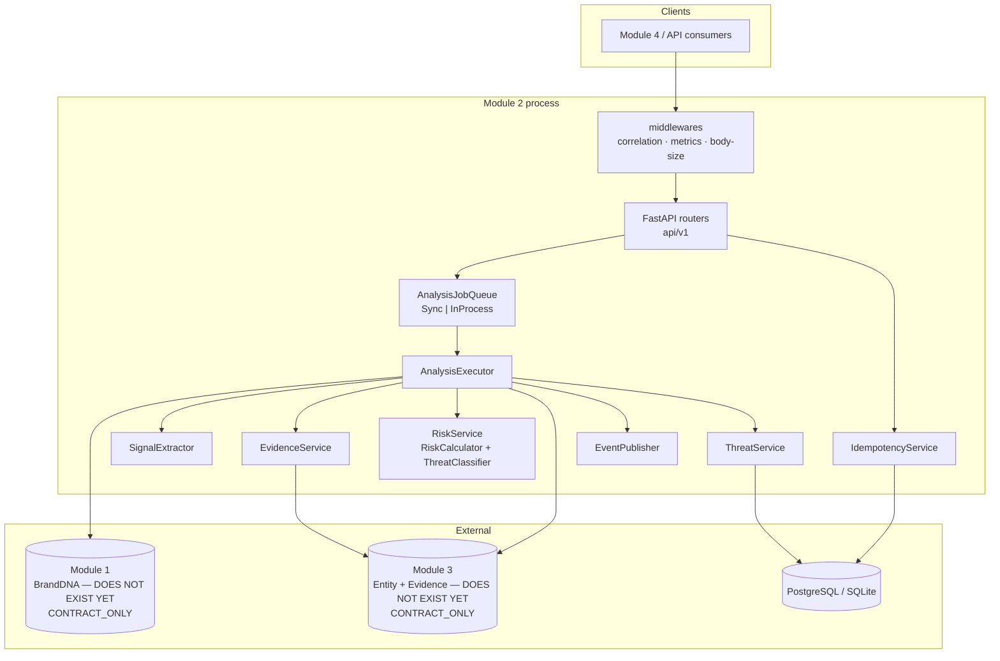
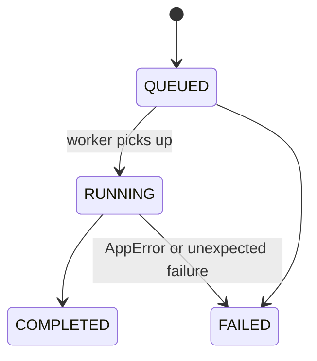
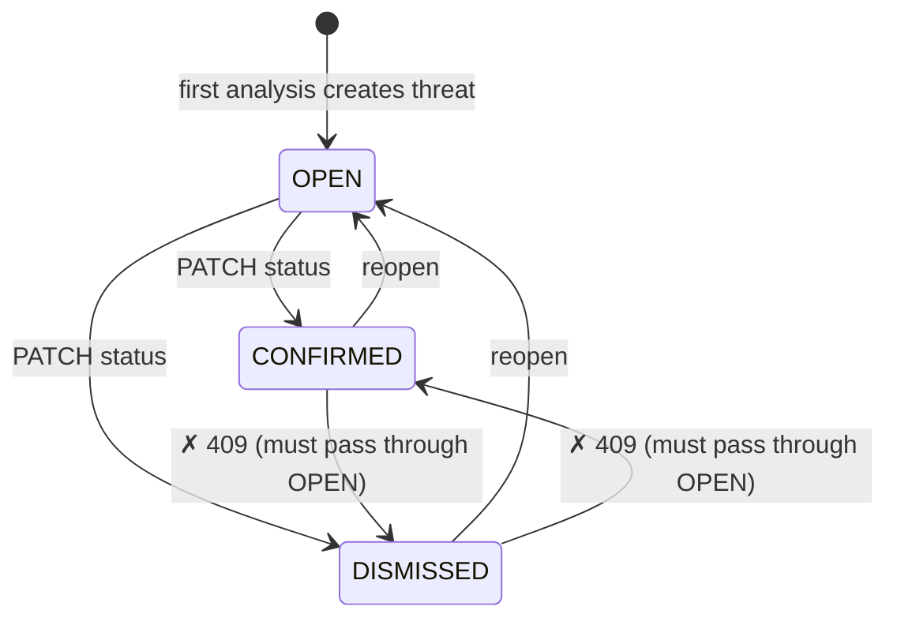
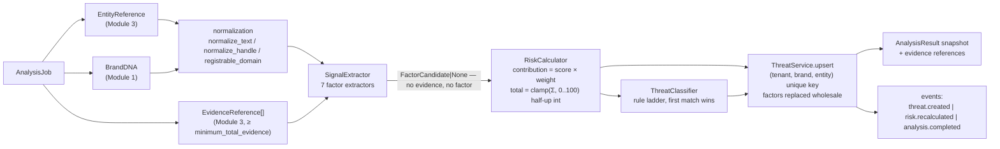

# Module 2 — Low-Level Design

All diagrams reflect the code as implemented and verified by the test suite
(93 tests passing, 2026-10-08).

## Module map

```
backend/
├── alembic/                     # migrations (single revision: module_2_initial_tables)
├── alembic.ini
├── pyproject.toml
└── app/
    ├── main.py                  # create_app(settings, *, engine=None); lifespan wiring
    ├── database.py              # engine/session helpers
    ├── api/
    │   ├── deps.py              # get_db, get_tenant, get_idempotency_key, settings
    │   └── v1/
    │       ├── analysis.py      # POST /analysis, GET /analysis/{job_id}
    │       └── threats.py       # GET/PATCH /threats — Module 4 contract surface
    ├── core/
    │   ├── config.py            # Settings (env prefix TRUSTGRAPH_)
    │   ├── errors.py            # ErrorCode enum + typed AppError subclasses
    │   ├── logging.py           # JSON logs, correlation/request context, audit helper
    │   └── observability.py     # dependency-free Prometheus-format registry
    ├── domain/enums.py          # RiskLevel, JobStatus, FactorType, EvidenceBasis, ...
    ├── events/
    │   ├── schemas.py           # 6 event models + envelope builder
    │   └── publisher.py         # EventPublisher protocol; InMemory (MOCK) / Logging
    ├── integrations/
    │   ├── module1/             # BrandDNAClient protocol; HTTP + Mock adapters
    │   ├── module3/             # EntityProvider/EvidenceProvider; HTTP + Mocks
    │   └── module4/             # boundary notes only (no adapter needed)
    ├── ml/
    │   ├── interfaces.py        # Text/Visual/Identity similarity protocols
    │   ├── text.py              # char-ngram cosine + optional sklearn adapter
    │   ├── visual.py            # pHash Hamming
    │   ├── identity.py          # 0.5·Levenshtein + 0.5·token Jaccard
    │   └── registry.py          # ModelSet (frozen) built from settings
    ├── models/                  # SQLAlchemy 2.x ORM (see DATA_MODEL.md)
    ├── risk/
    │   ├── config.py            # RiskEngineConfig — the ONLY home of weights/thresholds
    │   ├── calculator.py        # contribution = score × weight; clamp; half-up round
    │   └── classifier.py        # deterministic rule ladder
    ├── schemas/                 # Pydantic v2 DTOs (API + cross-module contracts)
    └── services/
        ├── analysis.py          # AnalysisExecutor — pipeline orchestration
        ├── normalization.py     # pure text/handle/domain normalizers
        ├── signal_extraction.py # evidence → FactorCandidate (no evidence → no factor)
        ├── evidence.py          # EvidenceService: minimum-evidence gate + citation map
        ├── risk_service.py      # calculator+classifier facade; factor signatures
        ├── threat_service.py    # threat upsert, factor replacement, result snapshots
        ├── jobs.py              # JobService create/get/list
        ├── idempotency.py       # fingerprint + replay/conflict semantics
        └── queue.py             # AnalysisJobQueue protocol; Sync + InProcess impls
```

## Component diagram



## Sequence: POST /api/v1/analysis (sync worker mode)

```mermaid
sequenceDiagram
    participant C as Client
    participant A as API (analysis.py)
    participant I as IdempotencyService
    participant DB as Database
    participant Q as SyncJobQueue
    participant X as AnalysisExecutor
    participant E as External (M1/M3)

    C->>A: POST /api/v1/analysis<br/>X-Tenant-ID, [Idempotency-Key]
    A->>I: submit(tenant, brand, entity, key, fingerprint)
    alt same key + different fingerprint
        I-->>A: DuplicateJobError → 409 DUPLICATE_JOB
    else same key + same fingerprint
        I-->>A: existing job (created=False)
    else new key / no key
        I->>DB: INSERT analysis_jobs [+ idempotency_records]
    end
    A->>DB: commit (before enqueue — workers use own session)
    A->>Q: enqueue(job_id, correlation_id)
    Q->>X: execute(job_id) on fresh session
    X->>E: get_entity / get_brand_dna / list_evidence
    X->>X: extract factors → risk → classify
    X->>DB: upsert threat, replace factors, persist result + evidence refs
    X-->>Q: done (queue commits)
    Q-->>A: future resolves
    A->>DB: expire_all; reload job
    A-->>C: 200 AnalysisJobResponse (202 if accepted for async workers)
```

## Sequence: threat status update (Module 4 workflow)

```mermaid
sequenceDiagram
    participant C as Module 4
    participant T as threats.py
    participant DB as Database
    participant P as EventPublisher
    C->>T: PATCH /api/v1/threats/{id}/status {status}
    T->>DB: SELECT threat WHERE id AND tenant_id
    alt not found (or other tenant)
        T-->>C: 404 NOT_FOUND
    else transition not in OPEN⇄CONFIRMED / OPEN⇄DISMISSED
        T-->>C: 409 INVALID_STATUS_TRANSITION
    else allowed
        T->>DB: UPDATE status; flush
        T->>P: publish threat.status_changed (prev → new)
        T-->>C: 200 ThreatResponse (with evidence_references)
    end
```

## State machines

Job status (`JobStatus`):



Threat status (`ThreatStatus`, analyst-owned):



## Pipeline data flow (per job)



## Key invariants enforced in code

1. **No evidence, no factor** — every extractor returns `None` without
   supporting evidence (`signal_extraction.py`); the calculator additionally
   drops candidates under `minimum_evidence_per_factor`.
2. **Determinism** — frozen dataclasses end-to-end (`FactorCandidate`,
   `FactorInput`, `ComputedFactor`, `RiskBreakdown`, `ModelSet`); same inputs
   → byte-identical scores; proven by a dedicated test.
3. **Transaction ownership** — routes/services only `flush()`; `get_db`
   commits request work, the queue commits worker work, the executor alone
   commits its FAILED bookkeeping (after rollback) so failure state survives.
4. **Versioned semantics** — `engine_version` and `model_version` are stored
   on every Threat/AnalysisResult; changing weights means shipping a new
   `ENGINE_VERSION`, never silently reinterpreting history.
5. **API never calls ML directly** — routes touch only services; ML is
   reachable solely through `ModelSet` built in the lifespan.
