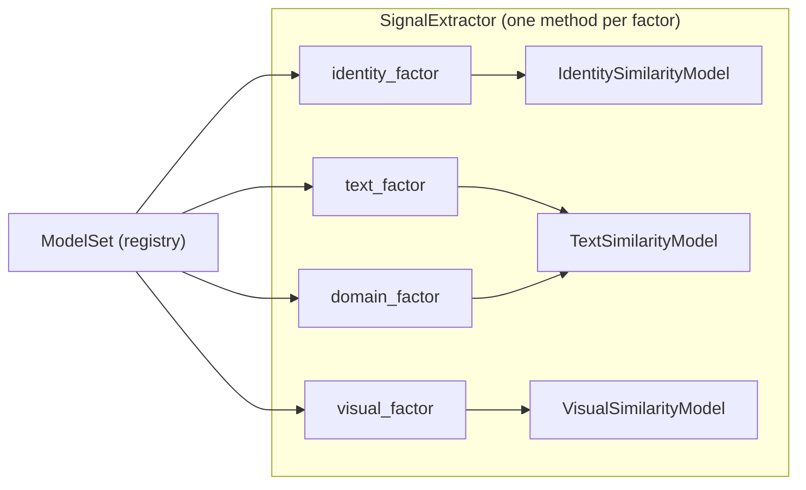

# Module 2 — ML Architecture

Principle: **models are replaceable components behind protocols**. No API
route and no risk rule ever imports an ML library. Models return a
normalized similarity in `[0.0, 1.0]` and nothing else — scoring semantics
stay in the risk engine.

## Interfaces (`app/ml/interfaces.py`)

```python
@runtime_checkable
class TextSimilarityModel(Protocol):
    name: str; version: str
    def similarity(self, reference: str, candidate: str) -> float: ...

class VisualSimilarityModel(Protocol):   # perceptual hashes (hex)
    name: str; version: str
    def similarity(self, reference_hash: str, candidate_hash: str) -> float: ...

class IdentitySimilarityModel(Protocol): # brand name/handle vs entity handle/name
    name: str; version: str
    def similarity(self, reference: str, candidate: str) -> float: ...
```

All models are deterministic pure functions of their inputs (no network, no
training inside the request path, no hidden state). Any future embedding /
LLM-backed model must preserve: determinism, `[0,1]` range, no I/O inside
`similarity()`.

## Registry (`app/ml/registry.py`)

Selection is configuration-driven (`TRUSTGRAPH_TEXT_MODEL`,
`TRUSTGRAPH_VISUAL_MODEL`, `TRUSTGRAPH_IDENTITY_MODEL`). Unknown names raise
`ModelUnavailableError` **at startup wiring time** — never mid-analysis.
`ModelSet` is a frozen dataclass exposing `version_string`, persisted as
`model_version` on Threat/AnalysisResult:

```
char_ngram_tfidf@1.0+phash_hamming@1.0+token_similarity@1.0
```

(major.minor per model keeps the composite within the 64-char column;
patch-level changes do not alter scoring semantics).

| Catalog key | Class | Backend |
|---|---|---|
| text: `char_ngram_tfidf` (default) | `CharNGramTextSimilarity` | pure-Python char 3-gram cosine |
| text: `sklearn_tfidf` | `SklearnTFIDFTextSimilarity` | scikit-learn char_wb 2–4 gram TF-IDF cosine — OPTIONAL, requires `pip install ".[ml]"`, raises `ModelUnavailableError` if sklearn absent |
| visual: `phash_hamming` (default) | `PhashHammingVisualSimilarity` | pure-Python Hamming over hex→bit expansion |
| identity: `token_similarity` (default) | `TokenIdentitySimilarity` | `0.5 × Levenshtein ratio + 0.5 × token Jaccard` |

## Baseline model details

**CharNGramTextSimilarity** (`text.py`): lowercase, whitespace-collapse, char
3-grams (short strings fall back to the whole string), cosine over Counters.
Robust to obfuscation like `accme-support.com` vs `acme-support.com`.

**PhashHammingVisualSimilarity** (`visual.py`): hex → bits, pad to equal
width, `1 − hamming/width`. Invalid hex characters are skipped (non-fatal);
empty input → 0.0. Module 2 never fetches raw images — hashes come from
BrandDNA `visual_assets[].content_hash` and evidence `image_hash`.

**TokenIdentitySimilarity** (`identity.py`): tokens split on
`[\s._\-@]+`; edit-distance ratio dominates for short handles, token overlap
tolerates word-order/punctuation noise in longer names. Output clamped to
[0,1].

## Pipeline integration



Extraction is separate from inference (models called only inside
`SignalExtractor`) and from risk calculation. Rules are deterministic and
documented in RISK_ENGINE.md. A factor is produced **only** when supporting
evidence exists.

## Upgrade path (designed, not implemented — labeled TBD/EXTERNAL_DEPENDENCY)

1. **Embedding text model**: implement `TextSimilarityModel` with a local
   sentence-transformers model; add to `TEXT_MODELS`; flip the env var. The
   commented `sentence-transformers` extra in `pyproject.toml` marks this as
   an opt-in multi-GB dependency, deliberately not bundled.
2. **Learned visual model** (e.g., CLIP embeddings): same protocol; the
   BrandDNA contract already carries opaque `content_hash` strings, but a
   vector-based model needs a contract change (vector column or embedding
   service) — that is a `CONTRACT_PROPOSED` evolution with Module 1.
3. **Identity resolution** beyond string similarity (graph features,
   behavior-history): new `IdentitySimilarityModel` implementation; FactorType
   semantics unchanged.
4. **LLM usage policy**: an LLM may only ever *summarize* persisted factors.
   It must NOT decide risk, weights, or classification — the risk engine is
   deterministic by contract.
